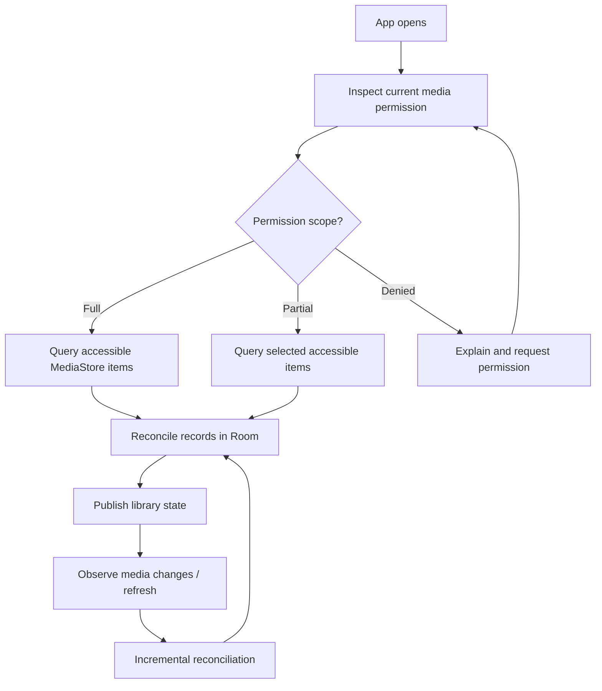
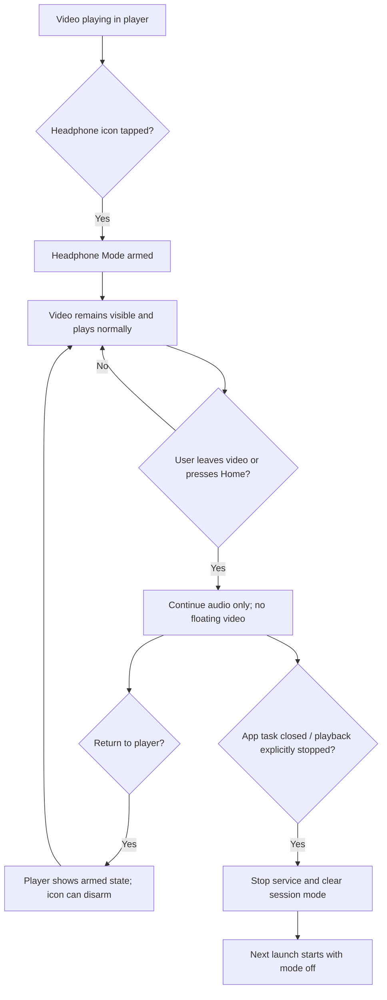
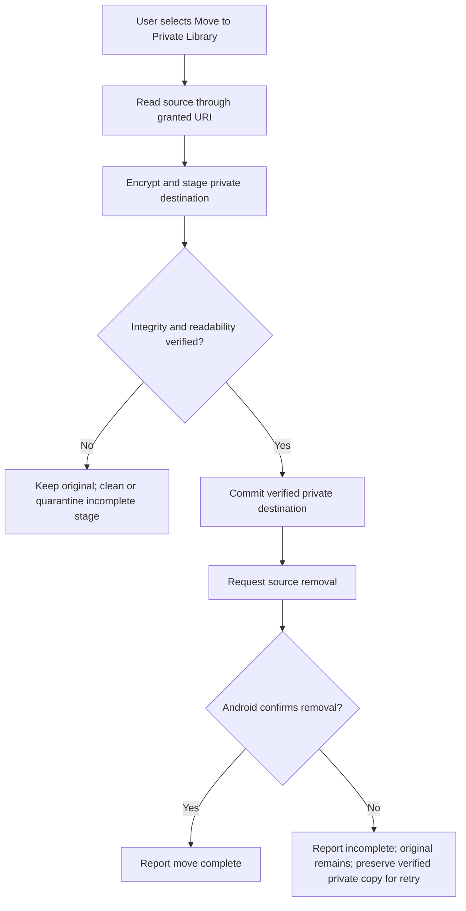

# Northstar Player — Integrated Implementation Plan

**Prepared:** 23 November 2026  
**Status:** USER-APPROVED — implementation in progress (approval confirmed in the project conversation)  
**Product authority:** `NORTHSTAR_PRODUCT_SPEC.md`  
**Branch audited:** `phase-0/release-signing`  
**Repository:** https://github.com/afghanbark573-rgb/Northstar-Player

> This plan translates the eight locked product discussions into an engineering approach. It does not change source code, select a final playback engine, or authorize an APK release. User-approved product requirements remain locked; technical choices marked **Proposed** are recommendations for review.

---

## 1. Executive direction

Build Northstar as a native, local-first Android media player with a folder-focused library, a custom playback experience, a separately protected private library, and dependable support for internal and removable storage.

Deliver all eight product areas as **one coordinated product release**. Work may proceed through internal engineering and test milestones, but do not ship separate public releases for individual discussion areas or create interim APKs merely to repackage existing behavior.

The current native branch is a starting prototype, not the target product. Implementation must be based on the approved product specification and verified against the live source at the time work begins.

### Non-negotiable safeguards

- Preserve application ID/namespace `com.northstar.player`.
- Preserve the permanent release-signing certificate and existing signed release workflow.
- Never expose or commit signing secrets or keystore bytes.
- Do not merge `main` and `phase-0/release-signing` casually.
- Do not claim a CI build proves real-device correctness.
- Do not claim Xiaomi 14 testing until the user has tested the APK.
- Do not silently drop requirements that prove technically unsupported; report the limitation and seek a decision.
- Keep the web prototype 0.8 frozen unless a material native-development blocker appears.

---

## 2. Live source baseline and gap assessment

### 2.1 What was inspected

A read-only inspection was performed against the current `phase-0/release-signing` branch. Files inspected included:

- `android/app/src/main/java/com/northstar/player/MainActivity.kt`
- `android/app/build.gradle.kts`
- `android/app/src/main/AndroidManifest.xml`
- `android/settings.gradle.kts`
- `.github/workflows/android-build.yml`
- `PROJECT_STATUS.md`
- `NORTHSTAR_PRODUCT_SPEC.md`

No application source code was changed and no build was triggered during this inspection.

### 2.2 Current implementation observed

- One `MainActivity.kt` currently owns the library UI, permission request, MediaStore query, filtering, sorting, folder grouping, player setup, and lifecycle behavior.
- MediaStore scanning is performed synchronously from the Activity flow rather than through a background repository/dispatcher.
- The current library has basic search, Folders/All Videos switching, List/Grid switching, Recent/A–Z/Largest sorting, and grouping using MediaStore relative paths.
- The folder display is a first grouping pass; it is not the approved three-mode library or full nested folder browser.
- The current UI is a functional shell and does not implement the approved AMOLED black-and-white design, top navigation, or You page.
- Playback uses standard Media3 `PlayerView` controls. The approved custom player, gesture system, time-display toggle, hold-for-2×, subtitle/audio track UI, persistent resume, and background audio service are not implemented in the inspected Activity.
- The app Gradle file currently includes Core KTX, Activity KTX, Media3 ExoPlayer and Media3 UI. No Room, coroutine, WorkManager, Paging, or test dependencies were found in that file.
- The manifest includes video permissions, including Android 14 selected-visual-media permission, but the Activity callback does not model full, selected/partial, denied, and reselection states as distinct library states.
- No automated `test` or `androidTest` source tree was present in the inspected source listing.
- Release signing and the GitHub Actions signed APK workflow are already configured. Preserve them.

### 2.3 Gap matrix

| Product area | Current evidence | Required target | Gap |
|---|---|---|---|
| Product UI | Functional prototype shell | AMOLED black/white, top navigation, You page | Major |
| Library modes | Folders/All Videos toggle | Video Folders, Files Only, Nested View | Major |
| Folder navigation | Relative-path grouping | Real hierarchy and folder navigation | Major |
| Unified controls | Separate inline buttons | One controls area for Sort, View Mode, Layout | Major |
| Persistence | In-memory list/state | Room-backed library metadata, history, favorites, progress | Major |
| Scanning | Synchronous MediaStore query | Background, incremental, lifecycle-safe scanning | Major |
| Permissions | Basic permission request | Full/partial/denied/reselection handling | Major |
| Player | Standard Media3 PlayerView | Custom player and approved controls/gestures | Major |
| Playback memory | Not found | Per-video resume and history | Major |
| Tracks/subtitles | No custom selection UI found | Embedded/external subtitles and audio track selection | Major |
| Private Library | Not found | Encrypted, authenticated, folder-organized private storage | Major |
| USB/SD | No SAF browser found | User-granted removable-storage browsing | Major |
| Tests | No test source sets found | Automated and device regression coverage | Major |
| CI signing | Configured | Preserve and verify | Existing foundation |

**Important:** “Not found” means not present in the inspected source paths; it is not a claim about uninspected historical branches or previous APK internals.

---

## 3. Proposed application architecture

### 3.1 Structure

**Proposed:** Keep one Android application and organize it into maintainable feature and data layers. Avoid putting new features into a replacement mega-Activity.

Suggested package layout:

```
com.northstar.player/
  app/
    NorthstarApplication
    MainActivity
    navigation/
  core/
    model/
    database/
    datastore/
    permissions/
    storage/
    security/
    diagnostics/
    ui/
  feature/
    library/
    folder/
    player/
    you/
    favorites/
    history/
    private/
    settings/
  data/
    library/
    playback/
    private/
    external/
  service/
    playback/
  worker/
    library/
  test/
```

This is a logical package plan, not a requirement to split into many Gradle modules immediately. Start with a single app module and clear boundaries; split modules only when build/test ownership or dependency boundaries justify it.

### 3.2 UI framework

**Proposed default:** Use native Android UI components with a consistent design system. The existing code uses Android Views. A framework change (for example, adopting Jetpack Compose) should be decided deliberately before the final UI build, not mixed into unrelated storage/player work.

Regardless of framework:
- AMOLED black surfaces and white/grey text.
- High contrast and restrained accent use only if later approved.
- Reusable buttons, icon-and-text controls, list rows, folder rows, video tiles, dialogs, and player overlays.
- Touch targets and text remain readable on the Xiaomi 14.
- No bottom navigation.

### 3.3 State and data flow

- Screens observe state from ViewModels or equivalent presentation controllers.
- Repositories own data access and coordinate Room, MediaStore, and SAF.
- Long-running I/O runs off the main thread using Kotlin coroutines.
- UI state survives configuration changes and is restored where appropriate.
- Playback state is owned by the playback layer/service, not by a screen's transient view hierarchy.
- Errors are represented as explicit UI states, not only status text or swallowed exceptions.

---

## 4. Data and persistence design

### 4.1 Room as the persistence layer

Room/SQLite is the approved persistence direction. Proposed core records:

- **MediaItem:** stable source identity, content URI, display name, MIME type, duration, byte size, modified/added dates, source type, relative path/folder identity, availability.
- **Folder:** normalized folder identity, parent identity, display name, source/storage identity, derived video count and child-folder count.
- **Favorite:** media/folder identity and favorite timestamp.
- **PlaybackProgress:** media identity, last position, duration snapshot, completion state, last played timestamp.
- **WatchHistory:** playback session/event information needed to render chronological history.
- **ScanState:** source identity, last completed scan, permission scope, and reconciliation state.
- **NewContentState:** discovery timestamp/acknowledgement state used for folder NEW indicators.
- **PrivateFolder / PrivateMedia:** encrypted private-library hierarchy and encrypted-file metadata; never mix these records into the public MediaStore library.
- **ExternalTreeGrant:** SAF tree URI, persisted permission flags, display name, and availability state.

Use migrations from the first schema version. Do not clear the database on upgrade. Database identity must not depend only on display filename; duplicate filenames can exist.

### 4.2 Source of truth

- MediaStore remains the discovery source for ordinary shared/internal media.
- Room stores app-owned metadata, user choices, scan state, history, favorites, and playback positions.
- SAF is the access path for user-selected USB/SD folders and other document-provider locations.
- Do not copy all public media into private app storage just to build the public library.
- If a MediaStore item disappears, mark/reconcile it and retain or remove user metadata according to an explicit orphan policy; do not silently attach a favorite or history record to a different file with the same name.

### 4.3 History and resume behavior

- Save progress periodically during playback and at pause/stop/end.
- Resume prompt appears for unfinished videos, not for videos at or near completion.
- A completed video can remain in Watch History without being treated as unfinished.
- History is chronological and is the sole recently-watched destination; do not add a separate Recently Played section.
- Private videos must not enter public Watch History.

**Open technical value to set during implementation:** the exact completion threshold and progress-save interval. Proposed starting points are “near the final 5%” for completion and a short periodic save interval, then validate write frequency and reliability.

---

## 5. Media discovery, permissions, and external storage

### 5.1 MediaStore scanning

**Proposed approach:**

1. Determine current permission scope.
2. Query MediaStore on an I/O dispatcher.
3. Read only required columns and process results incrementally.
4. Upsert records into Room in bounded batches.
5. Publish scan progress/state without blocking scrolling or playback.
6. Use a MediaStore content observer to schedule reconciliation when media changes.
7. Use WorkManager for deferrable reconciliation/recovery, not as a substitute for immediate foreground refresh.
8. Handle cancellation, process death, and partial scans safely. A failed scan must not erase the last known-good library.
9. Avoid re-reading or re-hashing every file on every app launch.

A scan is complete only when its result has been committed consistently. Store a last-successful-scan marker; never advance it after a failed or interrupted scan.

### 5.2 Permission states

Model at least:

- Full video access.
- Selected/partial video access.
- Permission denied.
- Permission permanently denied / settings route where applicable.
- No accessible videos.
- Access changed since the last scan.

On Android 14+ and later versions, account for selected-media access and reselection. Re-check permissions when the app resumes and re-query the accessible set after the user changes selection. Do not assume a prior permission result remains valid forever.

No broad all-files permission for ordinary video discovery.

### 5.3 USB and SD cards

- Offer an understandable external-storage entry point.
- Use Android's Storage Access Framework (SAF) folder picker where required; ask the user to grant access to a USB/SD folder.
- Persist URI permissions when the provider supports it.
- Browse the selected tree and its nested directories; do not assume all USB/SD content is automatically indexed by MediaStore.
- Keep external sources distinguishable from internal storage.
- Handle removed/disconnected media without crashing. Show an unavailable-source state and restore access when reconnected/reselected.
- Playback should use the granted content URI directly where supported.
- Do not copy removable-storage files into the public library by default.

### 5.4 Unified library identity

MediaStore and SAF may expose different URI formats and metadata. Use a source-aware media identity so an item from a USB tree cannot collide with an internal MediaStore item. Test duplicate appearances if the same removable content is also indexed by MediaStore.

---

## 6. Library and main interface implementation

### 6.1 Main shell

- Launch into the folder-focused library.
- Top navigation: Northstar title on the left; Profile/You icon, unified Library Controls icon, and Search icon on the right, in that exact left-to-right order.
- The Profile/You icon opens the **You** page.
- The single Library Controls icon sits between Profile/You and Search. It opens one compact menu containing all three control groups: Sort (Date Added, Date Modified, A–Z, Largest), View Mode (Video Folders, Files Only, Nested View), and Layout (List, Grid). Each option/group is presented with a simple icon and text label. Do not add separate top-bar buttons for these controls.
- Keep the bottom area free of bottom-navigation controls.
- Keep the player hidden until a video is selected.
- Keep the home screen focused on folders; do not add Favorites, History, Recently Added, or Smart Collections as home sections.

### 6.2 Three library View Modes

Exactly three modes:

1. **Video Folders:** show only folders that contain videos. Do not show empty folders or unrelated folders.
2. **Files Only:** show video files without folder listings.
3. **Nested View:** show the complete folder hierarchy, including main folders, nested folders, and folders containing videos. This is the all-folders hierarchy mode, not a fourth mode.

By Folder / Video Folders is the default starting mode.

Nested View uses normal folder-opening navigation, not an expandable/inline tree. Tapping a folder opens a folder page showing its child folders and files while preserving the actual parent-child hierarchy. Provide:
- A Back control for returning to the previous folder.
- A breadcrumb path near the top showing the current location and allowing navigation to ancestor folders. Keep it compact and usable on narrow phone screens (horizontal scrolling or an equivalent compact treatment is acceptable).
- A Create Folder icon in the toolbar.
- One compact controls icon that opens the unified Sort, View Mode, and Layout options; do not scatter these options across separate toolbar buttons.
- Pull-to-refresh on the folder page to refresh its contents.
Nested View includes empty folders and the complete hierarchy; it is not flattened and is not an expandable tree.

### 6.3 Unified controls

A single, easy-to-find controls area contains:
- Sort (icon + text).
- View Mode (icon + text).
- Layout (icon + text).

List/Grid applies to folders and video files. Do not scatter these controls into unrelated menus. The control area should remain compact and legible.

Sort options:
- Date Added — newest first, using the storage provider's added/indexed date where available.
- Date Modified — newest first, using the file's last-modified date where available.
- A–Z.
- Largest.

Date Added and Date Modified are separate user-facing sort options; do not collapse them into a generic Recent option. The underlying date fields can differ by source (MediaStore versus SAF document provider). If a provider does not expose a reliable date, handle the item consistently and do not invent a timestamp. Keep folder NEW-indicator state separate from these sort keys.

### 6.4 Search and folder indicators

- Search video filenames and relevant folder names/paths.
- Search results should clearly identify their containing folder.
- Folder-level NEW indicators appear only when relevant new content exists.
- NEW state must be stable across app restarts and should clear according to a defined acknowledgement rule (for example, when the folder is opened); finalize that rule before implementation.
- Do not create a Recently Added page/section.

### 6.5 You page

The You page is the single home for secondary destinations and settings. It contains:
- Favorites.
- Watch History.
- **Private Library** — a clearly visible, directly accessible destination alongside Favorites and Watch History.
- Settings.
- Other secondary options only when they are approved and useful.

Favorites is a separate section inside You, not a home-screen block. It can list favorited videos and folders. History replaces a separate Recently Played destination.

---

## 7. Player implementation and engine selection

### 7.1 Playback-engine benchmark gate

The final engine is not yet selected. Media3 ExoPlayer 1.11.1 is the current candidate, not a final commitment. Compare:

- AndroidX Media3 ExoPlayer.
- LibVLC.
- mpv.

Use the same representative test corpus and device conditions. Record:
- File open success and startup time.
- Video/audio correctness.
- Seeking accuracy and stability.
- Embedded subtitle discovery/rendering.
- External subtitle loading and rendering.
- Multiple audio/subtitle track selection.
- Portrait/landscape and rotation behavior.
- Long-playback stability.
- Memory, battery, heat, and app size.
- Integration complexity, maintenance, licensing obligations, and compatibility with custom UI.

Test available representative samples:
- MP4 / H.264 / AAC.
- MKV / H.264 / AAC.
- MKV / HEVC with common audio variants.
- MKV with text subtitles (SRT/ASS/SSA) and bitmap subtitles (PGS/VobSub) where available.
- External SRT/VTT and other formats actually required.
- Multiple audio and subtitle tracks.
- Long videos, seeking, rotation, and interrupted playback.

Do not promise universal codec/subtitle support. Record actual outcomes by sample and engine. Select the engine based on measured compatibility and maintenance trade-offs, then document the decision.

### 7.2 Custom player experience

The selected engine supplies playback; Northstar owns the visible control design.

Required:
- Play/Pause, Previous, Next, Rewind, Forward.
- Responsive seek timeline.
- Current time and total duration.
- Tap the total-duration display to toggle to remaining time.
- Double-tap seeking.
- Press-and-hold for temporary 2× playback; restore the previous speed on release/cancel.
- Persistent speed menu with multiple options and custom speed.
- Swipe gestures for brightness and volume.
- Portrait, landscape, and automatic orientation choices.
- Embedded and external subtitle selection.
- Audio-track selection.
- Fullscreen with controls that hide automatically.
- Per-video resume offer.
- Previous/Next follows the active folder or selected library context.

Approved gesture convention (23 November 2026): left-side vertical swipe controls brightness; right-side vertical swipe controls volume; double-tap left side seeks backward and double-tap right side seeks forward; press-and-hold temporarily switches to 2× and restores the prior speed on release/cancel. Design gesture zones and conflict handling so swipes, taps, and holds do not trigger accidentally; validate on the user's Xiaomi 14.

### 7.3 Background audio, Picture-in-Picture, and lifecycle

**Headphone / audio-only background behavior:** provide a headphone icon/control in the player that toggles a temporary, session-based mode. Tapping it arms audio-only background playback; it does not immediately close the video, hide the player, switch screens, or exit the app. Tapping the icon again while still in the video disarms the mode. While the user remains in that video, the video continues to play normally and remains visible. If the user presses Home or otherwise leaves/exits the video view while this mode is armed, playback continues as audio only (no floating video). Completely closing/terminating the app ends this mode and its background playback; it must not be restored on the next app launch, and it is off by default until the user activates it again with the icon. Use a MediaSessionService or equivalent service-backed playback architecture if validated for the selected engine; the service owns active playback and notification/media-session integration. The UI must make the armed state clear and provide a clear way to turn it off while the video is open.

**Picture-in-Picture (PiP):** support floating video playback as a separate experience from audio-only background playback. Provide both activation paths:
- A dedicated PiP icon/control in the player.
- Android Home-button activation to enter PiP when the user leaves the app.

Add a Settings toggle for **Automatically enter PiP when pressing Home** (on/off). When enabled, pressing Home while a video is playing enters PiP automatically. When disabled, pressing Home leaves the app normally and does not automatically enter PiP. The dedicated PiP icon remains visible/available and always enters PiP when tapped, regardless of this setting. Do not hide or disable the icon when automatic Home-button PiP is off. Do not conflate the headphone/audio-only action with PiP.

The selected playback engine and Android version may impose lifecycle/API constraints. Validate PiP transitions, playback continuity, controls, aspect ratio, and return-to-app behavior on supported Android versions and the user's Xiaomi 14. Activity/screen recreation must not unexpectedly destroy active playback.

### 7.4 Previous/Next context

Build a stable playback queue from the current context:
- Current folder.
- Files Only result set.
- Search results, if the user starts playback from search.

Preserve the active sort/filter order. Define behavior when a queue item becomes unavailable.

---

## 8. Private Library and security design

### 8.1 Private storage boundary

- Separate private repository and database records from the public media library.
- Private media must not appear in public MediaStore browsing, public search, Favorites, or public Watch History.
- Store private files in app-controlled storage and encrypt file contents.
- Use Android Keystore-backed key protection and authenticated encryption (for example, AES-GCM) after a security review.
- Avoid plaintext temporary copies and clean up partial imports safely.
- Exclude private media and sensitive metadata from backups, logs, diagnostics, and crash reports unless the user explicitly exports something.

### 8.2 Organization and import

- Private Library behaves as its own file manager.
- Create folders and subfolders.
- Import individual files or an entire selected folder tree.
- Preserve the source folder structure during folder import.
- Show progress, cancellation, insufficient-space errors, and partial-import recovery.
- The only user-facing import action is **Move to Private Library**; do not offer Copy or a separate Delete action in this workflow.
- Implement a safe move across Android storage providers as a staged transfer: encrypt/write to private storage, verify integrity and readability, commit the destination, then request source removal using the appropriate MediaStore/SAF permission flow.
- Never remove the source before the private destination is verified. If source removal is denied or unsupported, report the operation as incomplete and explicitly state that the original remains; do not claim the move succeeded. Preserve the verified private destination safely and support a clear retry/recovery path.

**User decision resolved (23 November 2026):** Move only. The user explicitly rejected Copy and selected Move as the sole user-facing import action. The safe staged-transfer and source-removal behavior above is an implementation safeguard, not a separate Copy/Delete workflow.

### 8.3 Private Library quick-access gesture

- On the main library and folder pages, a normal pull-down followed by release refreshes the current page.
- Pulling beyond the normal refresh threshold and holding briefly activates a distinct Private Library access gesture.
- This gesture opens only the Private Library authentication screen; it must never bypass PIN or biometric authentication.
- Provide clear visual feedback as the user crosses the threshold and while the hold is being recognized.
- Tune the threshold, hold duration, cancellation, and gesture arbitration to avoid accidental activation during ordinary refresh, scrolling, or folder navigation.
- The gesture is available on the main library and folder pages, not inside the video player.

### 8.4 PIN, biometrics, and recovery

- Require PIN and support biometric unlock.
- Rate-limit repeated PIN failures and avoid revealing whether a PIN guess is close.
- Use Keystore-protected keys; biometric enrollment/key invalidation must have a planned fallback.
- A forgotten PIN recovery process must not undermine encryption.

**User decision resolved — security-question experience (23 November 2026):**
- During setup, present a curated list of Northstar-provided security questions. The user selects any three and supplies answers; all three must be correct for forgotten-PIN recovery.
- Do not ask users to invent their own questions.
- Security questions are not cryptographic keys. Their answers may be guessable and must not be stored in plaintext. The implementation must use a reviewed cryptographic key-recovery design that protects against online guessing and offline attacks; do not weaken vault encryption merely to make recovery convenient.
- Recovery remains local-first, with no server-based recovery or automatic cloud upload.
- The exact key hierarchy, answer normalization, secure answer processing, rate-limiting, lockout policy, and recovery-key wrapping mechanism remain engineering design work and require security review before implementation.

### 8.5 Threat and privacy review

Before release, review:
- Rooted/compromised device limitations.
- App switcher/recents screenshot exposure.
- Clipboard and share-sheet exposure.
- Notifications and logs.
- Backup/restore behavior.
- Temporary files and failed imports.
- Authentication timeout and app backgrounding.
- Biometric lockout and PIN reset.
- Whether private media can be discovered by file managers or media scanners.

“Hidden from other apps where technically possible” must be described accurately; no app can guarantee secrecy on a fully compromised device.

---

## 9. Favorites, history, duplicates, and settings

- Favorites supports videos and folders, with a dedicated destination inside You.
- Watch History is chronological and does not create a second Recently Played section.
- Continue Watching/resume is based on per-video playback progress.
- Optional duplicate detection should begin with low-cost metadata candidates (size, duration, name/path) and offer an on-demand content-hash verification for likely matches. Do not hash the entire library on every launch or in the background without user awareness.
- Settings belongs under You. Organize settings into clear groups such as Playback, Library, Appearance, Storage & Permissions, Privacy & Security, and About/Diagnostics.
- Only include settings that correspond to implemented, tested behavior. Do not expose nonfunctional toggles.

---

## 10. Performance, reliability, and diagnostics

### Required engineering behavior

- Thousands of media entries do not freeze the UI.
- Scanning is cancellable and does not block playback, scrolling, or navigation.
- Room writes are batched and transactions are bounded.
- Thumbnails load asynchronously, are cached, and do not decode full video files on the main thread.
- Database queries are indexed for common sort/filter operations.
- Large folder lists and video lists are paged or otherwise bounded; avoid rebuilding the entire view tree on every keystroke.
- Removed files and disconnected drives become unavailable states, not crashes.
- Failed scans/imports leave a consistent prior library and recoverable work state.
- Errors are actionable and understandable.
- Diagnostics are generated locally and shared only when the user explicitly requests it. Exclude media contents, private filenames/paths, PINs, keys, and tokens.

---

## 11. Screen-by-screen acceptance criteria

### A. Main Library
- Opens into the folder-focused library.
- AMOLED black-and-white visual direction is applied consistently.
- Top navigation is present; no bottom navigation.
- Profile icon opens You.
- Player is not shown until a video is selected.
- Sort, View Mode, and Layout live together in one icon-and-text controls area.
- Default mode is Video Folders.
- Empty, loading, partial-access, denied-access, and error states are distinct and understandable.

### B. Video Folders
- Shows only folders that contain videos.
- Folder counts are correct for the selected source/access scope.
- Opening a folder shows its videos and nested folders according to the agreed navigation design.
- NEW indicators are consistent and persist across restarts until acknowledged.

### C. Files Only
- Shows video files without folder listings.
- List/Grid and all approved sorting options work.
- Search results identify the containing folder.
- Previous/Next queue follows the displayed/selected result context.

### D. Nested View
- Shows all folders, including empty folders and nested hierarchy.
- Parent/child relationships are accurate.
- Navigation does not flatten or misrepresent hierarchy.
- USB/SD trees remain distinguishable from internal storage.

### E. You
- Opens from the top profile icon.
- Contains clearly visible, directly accessible entries for Favorites, Watch History, Private Library, Settings, and approved secondary options.
- Private Library is discoverable from You without knowing the pull-and-hold shortcut; the gesture is only an additional shortcut.
- Does not turn the main Library into a dashboard.

### F. Player
- All approved controls, timeline toggle, gestures, temporary 2× hold, speed, orientation, tracks, subtitles, fullscreen, resume, and contextual Previous/Next work.
- Controls hide and reappear predictably.
- Headphone control starts/continues audio-only playback outside the app.
- The dedicated PiP icon is always visible/available and always enters PiP when tapped.
- Settings independently enables/disables only automatic PiP on Home-button press; turning it off never disables the PiP icon.
- Headphone mode is an explicit toggle: the icon arms it and the same icon disarms it while in the video; the video/player stays open and visible while the user remains there.
- When the user leaves the video/app with Headphone Mode armed, playback continues as audio only without floating video. Completely closing/terminating the app ends the mode and background playback; the next launch starts with Headphone Mode off, requiring the user to activate it again.
- Audio-only background playback and PiP remain distinct and do not trigger each other.
- Unsupported file/track cases show clear errors or unavailable options rather than crashing.

### G. Private Library
- Requires authentication.
- Imports individual files and full folder trees.
- Creates folders/subfolders.
- Encrypts stored content.
- Never leaks private items into public library/search/history/favorites/diagnostics.
- Recovery behavior is tested and clearly explained.
- Interrupted imports can be safely resumed, retried, or cleaned up.

### H. USB/SD
- User can grant a folder/tree.
- Files and nested folders can be browsed and played where supported.
- Access persists when the provider supports persisted grants.
- Disconnect/reconnect and revoked-permission states are handled.
- Internal library remains functional when external storage is unavailable.

### I. Reliability
- Large library scan does not freeze the interface.
- Playback remains responsive during scanning.
- Partial permission/reselection updates the visible library correctly.
- App process death does not corrupt library state or private imports.
- Diagnostics contain no private content.

---

## 12. Test strategy and release gates

### 12.1 Automated tests

Add unit tests for:
- Folder-tree construction and all three view-mode filters.
- Sorting and search.
- NEW indicator state/acknowledgement.
- Playback completion/resume decisions.
- Previous/Next queue construction.
- Database migrations and repository reconciliation.
- Duplicate candidate detection.
- Private folder hierarchy and import state transitions.
- Permission-state mapping.

Add instrumentation/integration tests for:
- Room persistence across process recreation.
- MediaStore repository behavior with test data.
- SAF grant persistence and revoked grants.
- Private encryption/decryption and authentication gates.
- Playback service lifecycle and media-session behavior.
- Navigation and key screen states.

### 12.2 Android permission/storage matrix

Test at minimum:
- Android 8–12: legacy media permission behavior.
- Android 13: READ_MEDIA_VIDEO grant/denial.
- Android 14+: full versus selected/partial access, reselection, and changed selections.
- Internal storage.
- SD card (when hardware/device supports it).
- USB OTG drive (when hardware/device supports it).
- Provider revoked, device disconnected, file deleted, and insufficient storage cases.

### 12.3 Playback corpus

Run the same test corpus against each engine candidate. Keep a recorded result sheet with device/OS, file details, open/play/seek/track/subtitle outcomes, stability, heat, battery, and notes.

### 12.4 Performance tests

- Small library, several thousand items, and a large stress library.
- Cold start and warm start.
- Initial scan and incremental refresh.
- Search typing, sort changes, folder navigation, thumbnail scrolling.
- Playback while scanning.
- Long-duration playback and repeated seek/rotation.
- Memory pressure and process recreation.

### 12.5 User-device acceptance

The user tests the integrated release on the Xiaomi 14. Do not mark device acceptance complete until the user confirms the APK has been installed and the agreed test scenarios pass.

### 12.6 Single coordinated release gates

A release candidate is eligible only when:
1. All eight discussion areas are implemented or any exception is explicitly approved.
2. Automated tests pass.
3. Engine benchmark and media corpus results are recorded.
4. Security/privacy review passes.
5. Signed release APK builds and signature verification succeeds.
6. Upgrade installation is verified over the existing signed app without changing application ID or signing identity.
7. User completes Xiaomi 14 acceptance testing.
8. Known limitations are documented.
9. One coordinated release package and release notes are prepared.

Internal CI artifacts may be used for engineering verification, but do not deliver or publish a partial feature release. Increment versionCode for the eventual installable release; do not create a user-facing release just to show incremental progress.

---

## 13. Implementation sequence (internal milestones, one public release)

These are development milestones, not separate product releases.

### Milestone 0 — Design and decisions
- Approve this plan.
- Resolve only genuine product decisions listed in Section 14.
- Create screen layouts and interaction specifications.
- Finalize acceptance criteria.

### Milestone 1 — Architecture and data foundation
- Establish package boundaries and app state architecture.
- Add Room and migrations.
- Add coroutine-based repositories.
- Add permission-state model.
- Preserve package identity, signing, and upgrade path.

### Milestone 2 — Library and storage foundation
- Background/incremental MediaStore scanning.
- Full/partial/denied/reselection handling.
- SAF external-storage browsing and persisted grants.
- Folder hierarchy and three View Modes.
- Unified controls, search, sort, List/Grid.
- Thumbnails and NEW state.

### Milestone 3 — Player engine and service
- Run engine benchmark and select engine.
- Add playback service/session.
- Add queue/context model.
- Implement custom player controls, gestures, tracks, subtitles, resume, and history.

### Milestone 4 — You and personal library
- You page, Favorites, Watch History, Settings.
- Private Library encryption, authentication, recovery, folder organization, and import.
- Optional duplicate detection.

### Milestone 5 — Integration and hardening
- Integrate all feature areas.
- Run full automated test suite.
- Performance, lifecycle, privacy, security, storage-disconnect, and media-corpus testing.
- Resolve regressions without scope creep.

### Milestone 6 — One coordinated release
- Version and release notes.
- Signed GitHub Actions build and signature verification.
- Upgrade-safety test.
- User Xiaomi 14 acceptance.
- Deliver the single integrated release candidate after all gates pass.

---

## 14. Resolved product decisions and remaining engineering gates

All currently identified user-facing product decisions are resolved and recorded in `NORTHSTAR_PRODUCT_SPEC.md`. This section is a continuity checklist, not a list of questions to reopen.

1. **Private import — RESOLVED:** Move only. No Copy option and no separate Delete action. Use the safe staged-transfer procedure in Section 8.2; if Android prevents source removal, report the move as incomplete and preserve the original.
2. **Private recovery experience — RESOLVED:** curated Northstar-provided question bank; user selects any three and answers all three. No user-created questions. Cryptographic recovery remains an engineering/security design task.
3. **Nested View — RESOLVED:** normal folder-opening navigation with folder page, Back, breadcrumb, Create Folder, unified controls, and pull-to-refresh. No expandable/inline tree.
4. **Sorting — RESOLVED:** Date Added and Date Modified (both newest first), A–Z, and Largest. Use provider values where reliable; never invent dates.
5. **Player gestures — RESOLVED:** left vertical swipe = brightness; right vertical swipe = volume; left double-tap = backward seek; right double-tap = forward seek; press-and-hold = temporary 2×.
6. **Top navigation — RESOLVED:** Northstar title on the left; Profile/You, unified Library Controls, Search on the right in that order; no bottom navigation.
7. **Headphone Mode and PiP — RESOLVED:** Headphone Mode is a session-only toggle, reset off on next launch; its icon arms/disarms audio-only continuation. Completely closing/terminating the app ends background playback. Dedicated PiP always works; Settings controls only automatic Home-button PiP.

### Engineering gates to close in the design and validation work

- Playback-engine benchmark and final engine selection.
- Security-reviewed Private Library key hierarchy and three-answer recovery design.
- Room schema, stable media identity, migrations, scan reconciliation, and NEW-indicator acknowledgement behavior.
- USB/SD disconnect/reconnect and permission-revocation behavior.
- Resume completion threshold, progress-save interval, and Previous/Next queue ordering.
- Headphone Mode task-removal/process-death/force-stop behavior and PiP lifecycle validation.
- Detailed visual specifications, screen layouts, accessibility, and acceptance tests.

These are engineering tasks. Do not turn them into a questionnaire unless investigation reveals a genuine product choice or a material risk to user data/security.
## 15. Screen-by-screen UX blueprint and system flows

This is a structural wireframe specification, not a final pixel design. It fixes hierarchy and navigation while leaving spacing, icon artwork, typography scale, and animation tuning to the visual design pass.

### 15.1 Main Library — default Video Folders mode

```text
┌──────────────────────────────────────────┐
│ Northstar                 You  Controls  Search │
├──────────────────────────────────────────┤
│ [Folder list or grid]                    │
│                                          │
│  Folder name                 NEW • count │
│  Folder name                       count │
│  Folder name                       count │
│                                          │
│  (No bottom navigation)                  │
└──────────────────────────────────────────┘
```

- Title stays left; right-side actions are You, unified controls, Search in that order.
- Folder content is the primary screen. No Favorites/History dashboard sections.
- Unified controls opens a compact grouped menu for Sort, View Mode, and Layout.
- Search opens a focused search experience; results show filename and containing folder.
- Loading, empty, permission-denied, partial-access, and scan-error states are distinct.

### 15.2 Video Folders and folder page

- Video Folders lists only folders containing accessible videos.
- Opening a folder navigates to a folder page; it does not expand an inline tree.
- Folder page toolbar: Back, compact breadcrumb, Create Folder, unified controls.
- The content area shows child folders and videos for the current location.
- Pull-to-refresh refreshes the current folder. The separate pull-past-threshold-and-hold shortcut opens only Private Library authentication.

### 15.3 Files Only

- Reuses the same top navigation and unified controls.
- Displays video files directly, with List/Grid layout and all four sort choices.
- Each search/result row identifies its containing folder.
- Starting playback captures the visible result order as the Previous/Next queue.

### 15.4 Nested View

- Shows the complete folder hierarchy, including empty folders.
- Folder rows navigate into their own folder page.
- Breadcrumb ancestors navigate directly to the selected ancestor.
- Do not flatten the hierarchy or implement an expandable/inline tree.

### 15.5 You page

```text
┌──────────────────────────────────────────┐
│ ← You                                    │
├──────────────────────────────────────────┤
│ Favorites                                │
│ Watch History                            │
│ Private Library                          │
│ Settings                                 │
└──────────────────────────────────────────┘
```

- Private Library is a visible destination, not a hidden gesture-only feature.
- Opening it always requires PIN or biometric authentication.
- Settings includes automatic Home-button PiP only; it does not control the dedicated PiP icon.

### 15.6 Player

- Full-screen video is the primary surface.
- Controls overlay includes Back, title, headphone toggle, dedicated PiP icon, playback controls, timeline/time display, speed, tracks/subtitles, orientation, and fullscreen as supported by the chosen engine.
- Headphone Mode has an unmistakable armed indicator and can be disarmed from the player.
- The dedicated PiP icon is always available regardless of the automatic-PiP setting.
- Gestures follow the locked left/right convention and are arbitrated against taps, holds, and system navigation.

### 15.7 Private Library

- Authentication gate precedes all private content.
- Private file-manager view supports folder/subfolder navigation, create-folder, and Move to Private Library.
- Import progress and failure states distinguish destination verification from source-removal success.
- PIN setup includes selection of three questions from Northstar's curated list.
- Recovery answers are never shown or stored as plaintext; private media and metadata stay outside public library/search/history/diagnostics.

### 15.8 USB/SD access

- External-storage entry point explains that Android may require the user to select a folder.
- After grant, browse the selected tree with source identity clearly distinguished from internal storage.
- Disconnected/revoked sources show an unavailable state and a route to reconnect/reselect; internal library remains usable.

### 15.9 Permission and media discovery flow



A failed or interrupted scan must never replace the last known-good library snapshot.

### 15.10 Playback and Headphone Mode lifecycle



Engineering must distinguish leaving the Activity (which may preserve service playback) from removing the app task, explicit stop, process death, and Android force-stop. The session flag must not be persisted as a preference or restored after a new app launch. Android may not provide a graceful callback for every process-kill/force-stop path; design the service and session token so playback cannot be resurrected on next launch, and verify task-removal behavior on device.

### 15.11 Private move flow



### 15.12 Approval boundary

The wireframes and flows above define the structure and system behavior for review. The engine benchmark, security design, schema/migrations, permission matrix, and device acceptance evidence remain engineering gates. No source-code changes or APK release are authorized by this design document alone.

## 16. Approval and implementation status

- [x] Eight product discussions completed and recorded.
- [x] Master product specification saved in GitHub.
- [x] Current native source re-inspected.
- [x] Initial gap assessment recorded.
- [x] Integrated implementation plan drafted.
- [x] User reviewed and approved this implementation plan.
- [x] Consolidate all currently identified product decisions as resolved in Section 14.
- [x] Prepare structural screen-by-screen wireframes and core data/permission/playback flow diagrams.
- [ ] Complete visual-detail review and engineering risk review.
- [x] Begin implementation after approval (in progress; see `PROJECT_STATUS.md` for evidence and verification state).
- [ ] Deliver one coordinated, tested product release.

**Current status: implementation in progress under the user's approval. Product decisions are resolved. Internal milestones may proceed, but the coordinated release remains gated on engineering validation, automated tests, security review, signed CI, upgrade verification, and Xiaomi 14 acceptance.**
